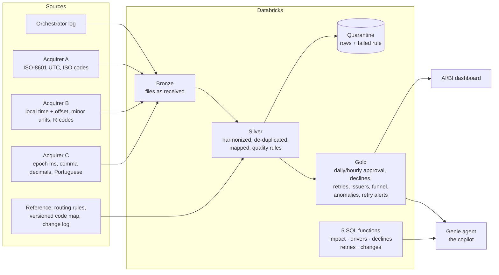

# Approval Rate Copilot

A text-to-SQL copilot for a payments team. Ask it why card approval rates dropped and it explains the cause and
the cost, then recommends a next step. Every number comes with the SQL behind it. It runs on Databricks Free
Edition with synthetic data.

[Project page](https://javisalazar31.github.io/approval-rate-copilot/), published from `site/index.html` with
GitHub Pages.

> This is a personal project. The orchestrator, acquirers, issuers, merchants and incidents are invented, and a
> script in this repository generates all the data. I used no employer data, systems, documents or incidents.

> In the synthetic scenario, on 13 August a routing change sent all Colombian domestic debit to the
> cheapest acquirer to save 40 bps. Final approval fell from 86.5% to 75.6% for 22 hours: 110 approvals and
> USD 6,354 of approved volume lost, against USD 180 of fees saved. A decline-code map released a week
> earlier had already switched off retries for that acquirer's "do not honor" declines. The copilot explains
> both causes in one answer, and a retry alert in the pipeline flags the second one in its first daily run,
> six days before the visible drop.

| | |
|---|---|
| **Problem** | Payments teams find approval drops late and are slow to explain them, because the data sits in an orchestrator log and three acquirer feeds with different formats, time zones and decline codes. |
| **Product** | A Databricks Genie agent that answers in plain language and shows the SQL behind every number. Five SQL functions hold the diagnostic method. A dashboard and two alerts complete it: one alert for approval drops and one for retries that stop working. |
| **Evidence** | A 20-question benchmark (16 questions with ground-truth SQL and 4 guardrails) and 14 held-out questions, with every answer and verdict published. Offline, with a Claude model in the copilot's place and a separate model as judge (LLM-as-a-judge), the design scored 18/20 on the first of six runs and 20/20 on each of the last three. The deployed Genie agent scored 13/20 on its first run, then 14, 15 and 17/20 as the method moved from text instructions into functions and example queries. On the held-out questions, committed before the run and asked once, it scored 11/14. The [evaluation write-up](evals/README.md) lists each failure with its cause and, where there is one, the fix. |
| **My role** | Product owner of the case. I set the brief (problem, scope, deliverables and acceptance criteria), and I own the product decisions in the [decision log](docs/decisions.md) and the evaluation rules. |
| **How it was built** | With an AI coding assistant. Claude (Anthropic) wrote the code and the first drafts of the documents from my brief, and ran the checks against the review bar I set. Automated tests cover the pipeline output, and the evaluation publishes every verdict. Each number on the project page traces back to SQL in this repository. |
| **Status** | The pipeline, functions, dashboard and Genie agent were deployed on Databricks Free Edition on 29 October 2026 through the Databricks APIs, and the data files match the local reference run byte for byte. The agent then went through three tuning rounds, each followed by the full benchmark on Genie, and one run on questions it was never tuned on. The next work is the chat-mode gaps that the benchmark and the held-out set found, and a larger held-out set. The [runbook](docs/runbook_databricks.md) explains how to deploy it yourself. |

---

## What is in the repository

```
data_generator/        Synthetic data: 90 days, 661k payment intents, 4 source formats, planted incidents
data/sample/           One day of every raw feed plus the reference tables, to look at without generating
sql/                   One SQL body per table and function (single source of truth)
  bronze/ silver/ gold/  Medallion layers
  ref/                 Reference tables (routing rules, versioned decline-code map, change log, FX)
  copilot/             The five diagnostic functions used by the copilot
databricks/
  pipeline/            Lakeflow pipeline (Spark Declarative Pipelines), generated from sql/
  notebooks/           00 setup · 01 generate data · 02 build without pipeline · 03 dashboard datasets
                       04 copilot functions · 05 column descriptions
  dashboard/           "Approval Health" as a dashboard file, for the Lakeview API
  genie/               The Genie agent as a serialized space, for the Genie API
local/                 Runs the same SQL on local Spark to validate everything before deploying
evals/                 Question set, model context, harness, results of each run
docs/                  PRD, metrics, decisions, postmortem, runbook, dashboard and Genie setup, data dictionary
site/                  Project page (built from the pipeline output and the eval results)
tests/                 Invariants of the pipeline output and a logic test of the retry alert
tools/                 Generators for the Databricks artifacts, docs and the project page
.github/workflows/     Publishes the project page with GitHub Pages
```

## Architecture



## Run it

### Locally

You need Python 3.11+ and Java 17 (Java 21 also worked).

```bash
pip install -r requirements.txt
python data_generator/generate_data.py --out data/full --seed 42   # under a minute
python local/run_local.py                                          # whole pipeline on local Spark, about 2 minutes, ~4 GB RAM
python tests/test_pipeline.py                                      # 7 checks
python tests/test_alert_logic.py                                   # the retry alert through a 20-day collapse, and where it stops
python -m pytest tests                                             # or all 9 tests at once, if pytest is installed
```

Tested with Python 3.13, Java 21, numpy 2.5.3, pandas 3.0.5 and pyarrow 26.0.0. The generator also ran with
numpy 2.1.3 and pandas 2.2.3 (the versions in Databricks serverless environment 4) and wrote byte-identical
files. The local Spark session runs in UTC with ANSI SQL mode on, like Databricks serverless.

### On Databricks Free Edition

Follow [docs/runbook_databricks.md](docs/runbook_databricks.md), through the UI or the APIs. It takes about an
hour, most of it waiting for compute.

### After a change

Regenerate what depends on it:

```bash
python tools/build_databricks.py   # pipeline SQL and notebooks 01, 02, 04 from sql/ and the generator
python tools/build_docs.py         # data dictionary, copilot context, notebook 05 (column descriptions)
python tools/build_deploy_payloads.py  # dashboard and Genie agent files for the API deployment
python tools/export_site_data.py   # numbers and chart data for the project page
python tools/build_site.py         # site/index.html (REPO_URL and SITE_URL add links and the preview image)
python tools/make_og_image.py      # optional: site/og.png, the link-preview image (needs Playwright)
```

To publish the page with GitHub Pages:

1. In the repository, set **Settings > Pages > Source: GitHub Actions** before the first push to `main`.
2. Rebuild the page with its public addresses, so the footer links to the documents and link previews show
   the image: `SITE_URL=https://<user>.github.io/<repo>/ REPO_URL=https://github.com/<user>/<repo> python tools/build_site.py`,
   then `python tools/make_og_image.py`.
3. Push. The workflow in `.github/workflows/pages.yml` publishes `site/index.html` and `site/og.png`
   whenever `site/` changes, and you can also run it by hand from the **Actions** tab.

## Product documents

| Document | What it covers |
|---|---|
| [PRD](docs/PRD.md) | Problem, users, goals and non-goals, solution, requirements with acceptance criteria, risks, rollout with success and stop criteria |
| [Metrics](docs/metrics.md) | Metric tree, definitions and choices, pitfalls, detection rules and their backtest |
| [Decision log](docs/decisions.md) | Twelve decisions with alternatives and trade-offs, including retry rules of the card networks |
| [Postmortem INC-0814](docs/postmortem_INC-0814.md) | Timeline, impact, root cause, detection gaps, action items |
| [Genie agent setup](docs/genie_space_setup.md) | Instructions, trusted functions, example SQL, benchmarks |
| [Dashboard setup](docs/dashboard_setup.md) | Pages, widgets and datasets of "Approval Health" |
| [Data dictionary](docs/data_dictionary.md) | Every table and column, generated from the pipeline output |
| [Demo script](docs/demo_video_script.md) | Storyboard of the 3-minute demo |

## Scenario planted in the data

| When (UTC) | Event | What the pipeline and the copilot should find |
|---|---|---|
| 18 Jun 12:00 to 20 Jun 18:00 | Risk rules v3 in Brazil, then tuned in v3.1 | Conversion falls on 18–19 Jun because risk blocks triple; authorization approval does not move |
| 2 Jul | Routing v13: 10% of Mexican debit to Acquirer C | A routing experiment; no incident |
| 21 Jul 12:00–15:00 | Issuer BR-ISS-03 maintenance (partner notice) | Issuer-side drop on every acquirer; retries cannot recover it |
| 6 Aug | Decline-code map v2.3 for Acquirer B | Fixes unmapped R65, but turns R05 "do not honor" into a hard decline: retries stop |
| 13 Aug 19:00 to 14 Aug 17:10 | Routing v14: all Colombian domestic debit to B, then rollback | −10.9 pp, 110 approvals and USD 6,354 lost in 22 hours |
| 15 Aug | Map hotfix v2.3.1 | Retries resume |
| 20 Aug | Two new merchants in Mexico | Mix change; no incident |

The data also contains the mess real feeds have: webhook re-deliveries, zero amounts, an undocumented code
and three time-zone conventions.

## Limitations

- The data is synthetic, and its parameters are illustrative assumptions, not market statistics. A pilot on real
  data is the next step.
- The benchmark questions drove the fixes, and the deployed Genie agent reached 17 of 20 on the fourth run, short
  of the PRD's 90% bar. On 14 held-out questions it scored 11. In chat mode it answers with a function's table
  and no text, so a question that asks by how much gets both numbers but never the gap (C1, and H6 in the
  held-out set). A text "NULL" passed for an optional parameter emptied one result (H7), and one diagnosis
  attributed a whole segment's lost approvals to a single acquirer (H8). The main diagnosis (B1) passed two of three
  samples in the last run.
- The offline evaluation puts a Claude model in Genie's place, with the same context. It tests the design
  (instructions, tables, functions) and says nothing about Genie's own model, and it overstated Genie: 20 of 20
  offline against 13 on the first Genie run.
- Detection is daily, and its thresholds come from the same 90 days they are tested on. There are no hourly
  alerts yet.

---

Built by Javier Salazar as a personal project. All data is synthetic: the orchestrator, merchants, issuers and
acquirers are fictional, and nothing here describes a real company. MIT license.
