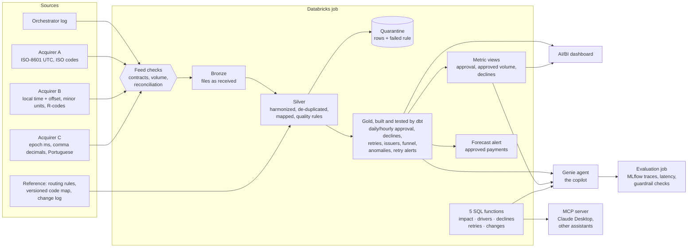

# Approval Rate Copilot

A text-to-SQL copilot for a payments team. Ask it why card approval rates dropped and it explains the cause and
the cost, then recommends a next step. Every number comes with the SQL behind it. It runs on Databricks Free
Edition with synthetic data.

[Project page](https://javisalazar31.github.io/approval-rate-copilot/), published from `site/index.html` with
GitHub Pages.

> This is a personal project. The orchestrator, acquirers, issuers, merchants and incidents are invented, and a
> script in this repository generates all the data. I used no employer data, systems, documents or incidents.

> In the synthetic scenario, on 13 August a routing change sent all Colombian domestic debit to the
> cheapest acquirer to save 40 bps. Final approval fell from 86.5% to 75.6% for 22 hours: 110 approvals and
> USD 6,354 of approved volume lost, against USD 180 of fees saved. A decline-code map released a week
> earlier had already switched off retries for that acquirer's "do not honor" declines. The copilot explains
> both causes in one answer, and a retry alert in the pipeline flags the second one in its first daily run,
> six days before the visible drop.

| | |
|---|---|
| **Problem** | Payments teams find approval drops late and are slow to explain them, because the data sits in an orchestrator log and three acquirer feeds with different formats, time zones and decline codes. |
| **Product** | A Databricks Genie agent that answers in plain language and shows the SQL behind every number. Five SQL functions hold the diagnostic method, and a small MCP server offers them to other assistants. A dashboard and three alerts complete it: one for approval drops, one for retries that stop working and one for approved payments that fall well below forecast. |
| **Evidence** | A 20-question benchmark (16 questions with ground-truth SQL and 4 guardrails) and three held-out sets of 40 questions in all, with every answer and verdict published. Offline, with a Claude model in the copilot's place and a separate model as judge (LLM-as-a-judge), the design scored 18/20 on the first of six runs and 20/20 on each of the last three. The deployed Genie agent scored 13/20 on its first run, then 14, 15 and 17/20 as the method moved from text instructions into functions and example queries, and 15/20 on the fifth run, after the gold layer moved to dbt and the metric views were added, and again on the sixth. On held-out questions, committed to the repository before each run, it scored 11/14 asked once, then 26 of 39 answers on 13 new questions asked three times each. The release after that addressed what those questions found, and on 13 more new questions, also asked three times each, it got 35 of 39 answers right, including all 21 chat-mode answers. Since the fifth run, each answer is an MLflow trace with its SQL, its guardrail checks and, when it was asked through Genie's APIs, its latency. The [evaluation write-up](evals/README.md) lists each failure with its cause and, where there is one, the fix. |
| **Analysis** | A difference-in-differences estimate against Colombian credit puts the cost of the routing change at 12.2 points of approval (95% CI 9.4 to 15.2), in line with the copilot's 10.9; on 55 dates with no change, the same estimate stays within 4 points of zero. Mix effects stay under 0.1 points: the same issuers and merchants were paying, and each of them approved less. A forecast alert on approved payments, with weekday and payday terms, adds cover for large losses before the acquirer: at the same false-alert rate, it caught 81% of days cut by 20% in three more synthetic datasets, against 54% for a same-weekday mean. See [impact and detection](docs/impact_and_detection.md). |
| **My role** | Product owner of the case. I set the brief (problem, scope, deliverables and acceptance criteria), and I own the product decisions in the [decision log](docs/decisions.md) and the evaluation rules. |
| **How it was built** | With an AI coding assistant. Claude (Anthropic) wrote the code and the first drafts of the documents from my brief, and ran the checks against the review bar I set. Automated tests cover the pipeline output, and the evaluation publishes every verdict. Each number on the project page traces back to SQL in this repository. |
| **Status** | The pipeline, functions, dashboard and Genie agent were deployed on Databricks Free Edition on 29 October 2026 through the Databricks APIs. The agent then went through three tuning rounds, each followed by the full benchmark on Genie, and one run on questions it was never tuned on. On 4 November 2026 one Databricks job ran the whole sequence: it regenerated the data, checked every feed against its data contract, rebuilt the pipeline with a column mask on the card's last four digits, wrote the forecast alert, recreated the functions and column descriptions, and tagged the tables in Unity Catalog. The 367 data files it wrote match the local reference run byte for byte, and the pipeline dropped the same 776 rows and raised the same two forecast alerts. On 4 and 5 November the gold layer moved to dbt, run as a task of the same job (17 models and 76 tests; the gold totals did not change), two Unity Catalog metric views took over the approval, volume and decline definitions, read by two dashboard datasets and by the agent, and an evaluation job began logging every answer to MLflow. Since 5 November the workspace deploys from this repository: a GitHub Actions workflow validates the Asset Bundle on every push and deploys it on demand, and its first deploy took over the existing pipeline, jobs and dashboard without recreating any of them. CI runs the tests, the whole pipeline and dbt on every push to main. On 12 November (UTC) the sixth release of the agent, with the fixes the second held-out set pointed to, was deployed and evaluated from GitHub Actions on the benchmark and a third held-out set, and a small MCP server began offering the five functions to other assistants, tested over the protocol on the deployed functions. The next work is what the sixth run and the third set found, starting with the main diagnosis, which failed all three samples, and two guardrail answers that offered to draft the update they had refused. The [runbook](docs/runbook_databricks.md) explains how to deploy it yourself. |

---

## What is in the repository

```
data_generator/        Synthetic data: 90 days, 661k payment intents, 4 source formats, planted incidents
data/sample/           One day of every raw feed plus the reference tables, to look at without generating
contracts/             One data contract per raw feed: columns, formats, volume and reconciliation rules
checks/                Feed checks against the contracts, run before the pipeline
sql/                   One SQL body per pipeline table and per function (single source of truth)
  bronze/ silver/      Ingestion and harmonization, with the quality rules
  ref/                 Reference tables (routing rules, versioned decline-code map, change log, FX)
  copilot/             The five diagnostic functions used by the copilot
dbt/                   The gold layer: staging, intermediate and mart models, with 76 tests
monitoring/            Forecast alert on approved payments (weekday and payday terms)
analysis/              Incident impact (difference-in-differences), mix/rate split, detector backtest
databricks.yml         Asset Bundle: the pipeline, the jobs and the dashboard, for deploys from GitHub Actions
databricks/
  pipeline/            Lakeflow pipeline (Spark Declarative Pipelines), generated from sql/
  jobs/                The daily job, the evaluation job and the agent update (Jobs API definitions)
  metric_views/        Two Unity Catalog metric views: approval and volume, declines
  notebooks/           00 setup · 01 generate data · 02 build without pipeline or dbt · 03 dashboard datasets
                       04 copilot functions · 05 column descriptions · 06 feed checks · 07 forecast alert
                       08 governance (tags, mask, lineage) · 09 metric views · 10 update the agent
                       11 evaluate the agent (MLflow)
  dashboard/           "Approval Health" as a dashboard file, for the Lakeview API
  genie/               The Genie agent as a serialized space, for the Genie API
local/                 Runs the same SQL on local Spark to validate everything before deploying
evals/                 Question sets, model context, harness, guardrail checks, MLflow runner, results
docs/                  PRD, metrics, decisions, postmortem, runbook, dashboard and Genie setup, data dictionary
site/                  Project page (built from the pipeline output and the eval results)
mcp_server/            MCP server: the five functions as read-only tools for Claude Desktop and other assistants
tests/                 Pipeline invariants, alert logic, feed contracts, forecast alert, incident analysis, MCP server
tools/                 Generators for the Databricks artifacts, docs and the project page
.github/workflows/     CI (tests, the whole pipeline and dbt on local Spark), the Databricks deploy, the evaluation,
                       the MCP server on Databricks, the project page
```

## Architecture



## Run it

### Quickstart

You need Python 3.11+ and Java 17 (Java 21 also worked).

```bash
pip install -r requirements.txt -r mcp_server/requirements.txt pytest
python local/run_local.py      # generates the data on the first run, then runs the whole pipeline on local Spark
python -m pytest tests         # pipeline invariants, alerts, feed contracts, guardrails, incident analysis, MCP server
```

The first run takes about three minutes and 4 GB of memory. The same steps one at a time:

```bash
python data_generator/generate_data.py --out data/full --seed 42   # under a minute
python checks/feed_checks.py --data data/full --all-dates          # every day of every feed against its contract
python local/run_local.py                                          # pipeline, dbt (gold and its tests), forecast alert
python analysis/incident_impact.py                                 # difference-in-differences for the incident
```

Tested with Python 3.13, Java 21, numpy 2.5.3, pandas 3.0.5 and pyarrow 26.0.0. The generator also ran with
numpy 2.1.3 and pandas 2.2.3 (the versions in Databricks serverless environment 4) and wrote byte-identical
files. The local Spark session runs in UTC with ANSI SQL mode on, like Databricks serverless.

### On Databricks Free Edition

Follow [docs/runbook_databricks.md](docs/runbook_databricks.md), through the UI or the APIs. It takes about an
hour, most of it waiting for compute. After the first deployment, one job (`databricks/jobs/`) runs every step
in order: setup, data landing, feed checks, the pipeline, the forecast alert, the copilot functions, column
descriptions and governance. Transient steps retry twice, the feed checks never retry, and a failure sends an
email to the job owner.

### From another assistant

[`mcp_server/`](mcp_server/README.md) offers the five functions as read-only MCP tools, on Databricks or on the
local pipeline output, with a configuration example for Claude Desktop.

### After a change

Regenerate what depends on it:

```bash
python tools/build_databricks.py   # pipeline SQL, notebooks 01, 02, 04, 06, 08 and the job definition
python tools/build_docs.py         # data dictionary, data model, copilot context, notebooks 05 and 07
python tools/build_deploy_payloads.py  # dashboard and Genie agent files for the API deployment
python tools/export_site_data.py   # numbers and chart data for the project page
python tools/build_site.py         # site/index.html (REPO_URL and SITE_URL add links and the preview image)
python tools/make_og_image.py      # optional: site/og.png, the link-preview image (needs Playwright)
```

CI rebuilds all of these except the preview image on every push to main and every pull request, and fails if a
committed file differs from what its sources produce.

To publish the page with GitHub Pages:

1. In the repository, set **Settings > Pages > Source: GitHub Actions** before the first push to `main`.
2. Rebuild the page with its public addresses, so the footer links to the documents and link previews show
   the image: `SITE_URL=https://<user>.github.io/<repo>/ REPO_URL=https://github.com/<user>/<repo> python tools/build_site.py`,
   then `python tools/make_og_image.py`.
3. Push. The workflow in `.github/workflows/pages.yml` publishes `site/index.html` and `site/og.png`
   whenever `site/` changes, and you can also run it by hand from the **Actions** tab.

## Product documents

| Document | What it covers |
|---|---|
| [PRD](docs/PRD.md) | Problem, users, goals and non-goals, solution, requirements with acceptance criteria, risks, rollout with success and stop criteria |
| [Metrics](docs/metrics.md) | Metric tree, definitions and choices, pitfalls, detection rules and their backtest |
| [Decision log](docs/decisions.md) | Twenty decisions with alternatives and trade-offs, including retry rules of the card networks |
| [Impact and detection](docs/impact_and_detection.md) | Difference-in-differences for the incident, mix/rate split, forecast alert and its backtest |
| [Postmortem INC-0814](docs/postmortem_INC-0814.md) | Timeline, impact, root cause, detection gaps, action items |
| [Genie agent setup](docs/genie_space_setup.md) | Instructions, trusted functions, example SQL, benchmarks |
| [Dashboard setup](docs/dashboard_setup.md) | Pages, widgets and datasets of "Approval Health" |
| [Data model](docs/data_model.md) | Entities and keys, gold-table grain, and table lineage read from the SQL |
| [Data dictionary](docs/data_dictionary.md) | Every table and column, generated from the pipeline output |
| [Demo script](docs/demo_video_script.md) | Storyboard of the 3-minute demo and of a 60 to 90 second cut |

## Scenario planted in the data

| When (UTC) | Event | What the pipeline and the copilot should find |
|---|---|---|
| 18 Jun 12:00 to 20 Jun 18:00 | Risk rules v3 in Brazil, then tuned in v3.1 | Conversion falls on 18–19 Jun because risk blocks triple; authorization approval does not move |
| 2 Jul | Routing v13: 10% of Mexican debit to Acquirer C | A routing experiment; no incident |
| 21 Jul 12:00–15:00 | Issuer BR-ISS-03 maintenance (partner notice) | Issuer-side drop on every acquirer; retries cannot recover it |
| 6 Aug | Decline-code map v2.3 for Acquirer B | Fixes unmapped R65, but turns R05 "do not honor" into a hard decline: retries stop |
| 13 Aug 19:00 to 14 Aug 17:10 | Routing v14: all Colombian domestic debit to B, then rollback | −10.9 pp, 110 approvals and USD 6,354 lost in 22 hours |
| 15 Aug | Map hotfix v2.3.1 | Retries resume |
| 20 Aug | Two new merchants in Mexico | Mix change; no incident |

The data also contains the mess real feeds have: webhook re-deliveries, zero amounts, an undocumented code
and three time-zone conventions.

## Limitations

- The data is synthetic, and its parameters are illustrative assumptions, not market statistics. A pilot on real
  data is the next step.
- The benchmark questions drove the fixes, and the deployed Genie agent reached 17 of 20 on the fourth run and 15
  on the fifth and sixth, short of the PRD's 90% bar. On held-out questions it scored 11 of 14, then 26 of 39
  answers on 13 questions asked three times each, mostly lost in chat mode: answers that were a function's table
  with no text (H6, N6, N7, and C1 on the benchmark), a metric view filtered on a value it does not have (N4) and a
  rule applied outside its scope (N3). The sixth release addressed those causes, and a third set of 13 new
  questions got 35 of 39, all 21 chat-mode answers right. Because the questions differ, this is not a
  before-and-after measure. The four answers it lost were in agent mode: one led with the recovery rate of all
  Brazilian traffic instead of the issuer's, one offered a count no query returned, and two offered to draft an
  update they had refused. On the benchmark, the main diagnosis (B1) passed two of three samples in runs 4 and 5
  and none in run 6, each sample failing on a different misreading of its own query results.
- The offline evaluation puts a Claude model in Genie's place, with the same context. It tests the design
  (instructions, tables, functions) and says nothing about Genie's own model, and it overstated Genie: 20 of 20
  offline against 13 on the first Genie run.
- Detection is daily. The approval-rate and retry thresholds come from the same 90 days they are tested on.
  The forecast alert was also tested on three more datasets from the same generator, which test new noise but
  not holidays or promotions, and its lower bound sits about 15% under the forecast, set mostly by day-to-day
  noise: too wide for any of the planted incidents. There are no hourly alerts yet.

---

Built by Javier Salazar as a personal project. All data is synthetic: the orchestrator, merchants, issuers and
acquirers are fictional, and nothing here describes a real company. MIT license.
