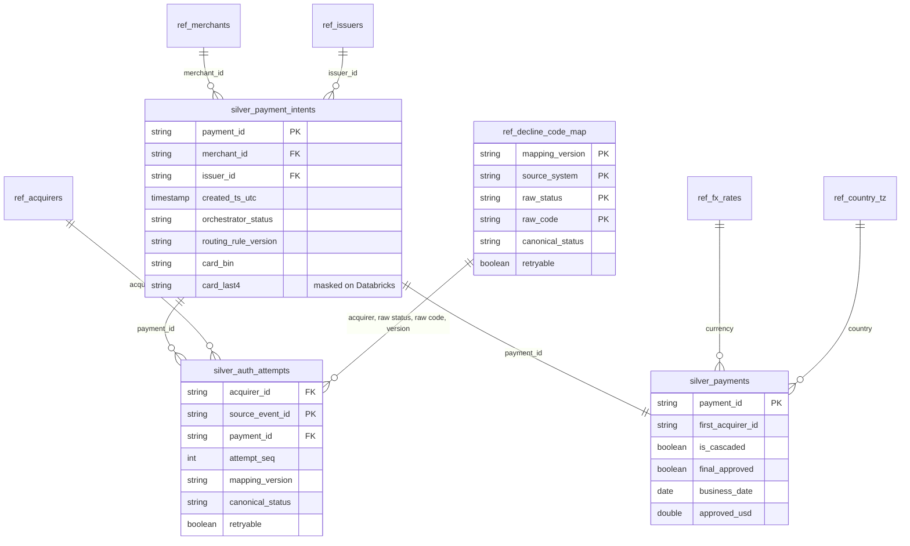
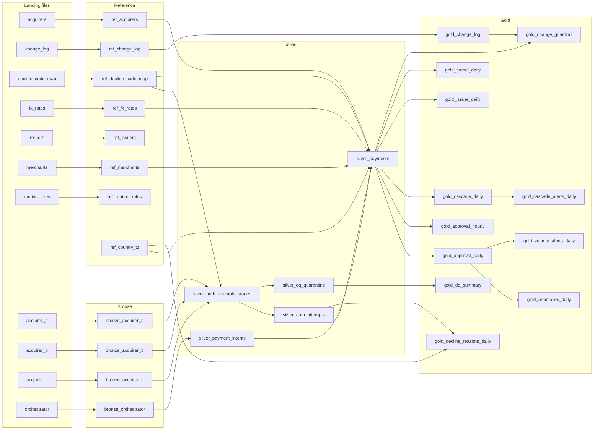

# Data model

Generated by `tools/build_docs.py`. The lineage below is read from the SQL of each table, so it always matches
the code. On Databricks, Unity Catalog also records table lineage when the pipeline runs (notebook 08 lists
it). Column details are in the [data dictionary](data_dictionary.md).

## Entities and keys (silver and reference)

One payment intent from the orchestrator has zero, one or two authorization attempts: none when risk blocked
it or the shopper abandoned 3DS, the first acquirer's attempt, and one retry on another acquirer when the
decline was retryable. `silver_payments` joins them into one row per payment. The versioned decline-code map
classifies each attempt with the map version active at that moment.

## Gold tables and their grain

| Table | Grain |
|---|---|
| `gold_approval_daily` | one row per local date × country × card type × first acquirer × cross-border flag |
| `gold_approval_hourly` | one row per local hour × country × card type × first acquirer × cross-border flag |
| `gold_decline_reasons_daily` | one row per local date × country × card type × acquirer × attempt number × reason × decline-code map version |
| `gold_cascade_daily` | one row per local date × country × card type × first acquirer × first-attempt reason × decline-code map version |
| `gold_issuer_daily` | one row per local date × country × issuer × card type × first acquirer |
| `gold_funnel_daily` | one row per local date × country × card type |
| `gold_anomalies_daily` | one row per local date × country × card type (domestic traffic) |
| `gold_cascade_alerts_daily` | one row per local date × country × first acquirer × first-attempt reason |
| `gold_change_log` | one row per production change |
| `gold_change_guardrail` | one row per production change × country × card type × cross-border flag × hour since the change (1 to 24) |
| `gold_dq_summary` | one row per source system × failed rule × raw status × raw code |
| `gold_volume_alerts_daily` | one row per local date × country × card type (all traffic) |

## Table lineage

`gold_volume_alerts_daily` is written by a job task after the pipeline; every other table is a pipeline
dataset.

